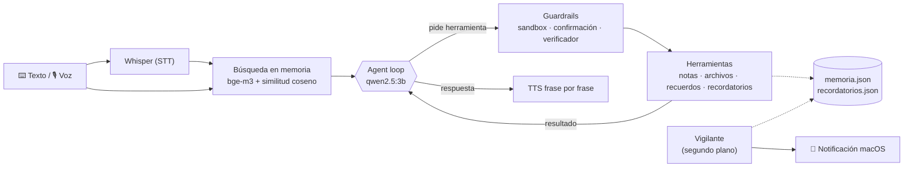

# Jarvis 🤖

**Asistente personal de IA por voz, construido desde cero, que corre 100% local en una MacBook Air M1 de 8 GB, sin costo y sin enviar datos a la nube.**

Jarvis conversa por texto o por voz, usa herramientas, recuerda cosas entre sesiones (RAG), avisa por iniciativa propia y se defiende de ataques de *prompt injection*. Su calidad se mide con evals automáticas.

Lo construí para aprender AI Engineering: el *agent loop*, el RAG y las defensas están programados a mano, sin frameworks como LangChain, para entender cada pieza por dentro.

> 🎬 **Demo:** _(agrega aquí el enlace a tu video)_

---

## ✨ Qué hace

| Capacidad | Cómo funciona |
|---|---|
| 🧠 **Conversa** | LLM local `qwen2.5:3b` (cuantizado a 4 bits) vía Ollama, con historial y *system prompt* |
| 🔧 **Usa herramientas** | *Tool calling* + *agent loop* propio (pensar → actuar → observar) con freno de 5 pasos |
| 📁 **Archivos** | Lee y escribe solo dentro de un *sandbox*, con confirmación humana para escribir |
| 💾 **Recuerda** | Memoria a largo plazo con **RAG**: embeddings `bge-m3`, similitud coseno, top-k y umbral calibrado |
| 🎙️ **Escucha** | Voz a texto con **Whisper** optimizado para Apple Silicon (MLX) |
| 🔊 **Habla** | Texto a voz **frase por frase mientras genera** (cola + hilo en segundo plano) |
| 🔔 **Toma la iniciativa** | Proceso en segundo plano que revisa recordatorios y avisa con notificaciones de macOS |
| 🛡️ **Se defiende** | 5 capas contra *prompt injection* + verificador de "alucinaciones de acción" |
| 🧪 **Se mide** | Evals automáticas de herramientas, memoria y velocidad |

## 🏗️ Arquitectura



**Idea central:** el LLM nunca ejecuta nada. Solo *pide* usar una herramienta; mi código la ejecuta, aplica las protecciones y le devuelve el resultado.

## 📊 Resultados medidos

**Evals** (`python3 evals.py`, temperatura 0 para que sean repetibles):

| Modelo | Elección de herramientas | Búsqueda en memoria |
|---|---|---|
| `qwen2.5:3b` ✅ (elegido) | **12/12 (100%)** | 6/7 (86%) |
| `llama3.2:3b` | 8/12 (67%) | 6/7 (86%) |

`llama` usaba herramientas hasta para contar un chiste. La memoria saca la misma nota con los dos porque depende del modelo de embeddings, no del LLM.

**Latencia de voz** (respuesta de 3 oraciones, modelos ya cargados):

| | Empieza a hablar |
|---|---|
| Esperando la respuesta completa | 6.6 s |
| Frase por frase (actual) | **3.3 s** |

## 🛡️ Seguridad

Probé un ataque real: un archivo con instrucciones escondidas que le ordenaban a Jarvis guardar un recuerdo falso. **El modelo cayó e intentó guardarlo**; lo detuvo la capa en el código.

1. **Delimitadores:** el contenido externo se marca como datos, no como instrucciones.
2. **Detector** de frases típicas de inyección.
3. **Reglas** en el *system prompt*.
4. **Contexto contaminado:** si en un turno se leyó un archivo, cualquier acción que guarde o cree algo exige confirmación humana. *(La que detuvo el ataque.)*
5. **Higiene del historial:** el contenido de los archivos se borra del historial al terminar cada turno.

Además: *sandbox* de archivos, *human-in-the-loop* para escribir y un **verificador** que rechaza respuestas del tipo "ya lo guardé" cuando no se usó ninguna herramienta.

**Principio:** las instrucciones en el prompt *reducen la probabilidad* de error; el código *garantiza* que un error no cause daño.

## 🚀 Cómo correrlo

Requisitos: Mac con Apple Silicon, Python 3.9+ y [Ollama](https://ollama.com).

```bash
# 1. Modelos (LLM + embeddings)
ollama pull qwen2.5:3b
ollama pull bge-m3

# 2. Entorno y dependencias
python3 -m venv venv
source venv/bin/activate
pip install -r requirements.txt

# 3. Jarvis (escribe, o Enter vacío para hablar; "salir" para terminar)
python3 jarvis.py

# 4. (Otra terminal) el vigilante de recordatorios
python3 vigilante.py

# 5. Evals
python3 evals.py
```

Para probar la defensa contra *prompt injection*, copia `ejemplos/noticia_con_inyeccion.txt` a `espacio_jarvis/` y pídele a Jarvis que lo lea.

## 📂 Estructura

| Archivo | Rol |
|---|---|
| `jarvis.py` | Programa principal: RAG, *agent loop*, guardrails y voz |
| `config.py` | Modelo, temperatura y *system prompt* (una sola fuente de verdad) |
| `herramientas.py` | Herramientas y sus definiciones (JSON Schema), *sandbox*, detector de inyección |
| `memoria.py` | Memoria a largo plazo: embeddings, similitud coseno, top-k y umbral |
| `recordatorios.py` / `vigilante.py` | Recordatorios y proceso proactivo en segundo plano |
| `oido.py` / `voz.py` | STT con Whisper y TTS en streaming |
| `evals.py` | Evals automáticas de herramientas, memoria y velocidad |
| `experimentos/` | Experimentos de aprendizaje (temperatura, embeddings) |
| `ejemplos/` | Archivos de ejemplo, incluido el del ataque de *prompt injection* |

## 💡 Lo que aprendí

**Fundamentos de LLMs**
- Un LLM predice el siguiente *token* una y otra vez; no tiene memoria (*stateless*): mi código le reenvía el historial en cada turno, dentro de una **ventana de contexto** limitada (32.768 tokens en `qwen2.5:3b`).
- La **temperatura** controla qué tan arriesgado es al elegir tokens: con 0 es repetible (clave para las evals); alta, creativo.
- Las **alucinaciones** se reducen con un buen *system prompt* y dándole datos reales, pero no desaparecen.
- La **cuantización** a 4 bits (Q4_K_M) hace que un modelo de 3.100 millones de parámetros ocupe ~2 GB en vez de ~6 GB. Sin ella, la IA local en una laptop de 8 GB no sería posible.

**Agentes**
- **Tool calling:** el modelo solo ve un "menú" (nombre, descripción y parámetros); la descripción decide cuándo elige cada herramienta. Dos descripciones que se pisaban causaron el único fallo de `qwen` en las evals.
- **Agent loop** con freno de pasos; cuando el modelo pedía herramientas en paralelo aunque dependieran entre sí, ejecuté una por vuelta y le recordé las pendientes.
- **Diseño de herramientas:** los cálculos exactos (fechas, horas) van en el código. El modelo puso "el viernes" en un domingo; ahora solo indica `dia_semana` y `hora`.
- **Las instrucciones sugieren, el código obliga:** *sandbox*, confirmaciones y verificador viven en el código.
- **Proactividad:** un proceso que revisa periódicamente (*polling*) y actúa cuando se cumple una condición (*trigger*). A más impacto de una acción, menos autonomía.

**RAG y memoria**
- Un **embedding** es un vector que representa significado; su dimensión depende del modelo (`bge-m3` = 1024). `nomic-embed-text` falló en español; `bge-m3`, multilingüe, funcionó.
- El **umbral** se calibra con datos: empecé con 0.55 a ojo y bloqueaba todo; midiendo, lo bajé a 0.45. En RAG suele ser peor un falso negativo que un falso positivo.
- Límite conocido: "¿qué almorzar?" trae la rutina del gimnasio. Mejora futura: *re-ranking* o búsqueda híbrida.

**Calidad, seguridad y rendimiento**
- **Evals** + **pruebas de regresión**: medir, arreglar, volver a medir todo.
- *Prompt injection* real, **defensa en profundidad** y el veneno que se queda en el historial.
- **Latencia:** en voz importa cuándo *empieza* la respuesta; el *cold start* (22 s la primera vez, 3 s después) muestra por qué nunca hay que confiar en una sola medición.

## 🗺️ Roadmap

- [x] v0 – Cerebro: chat con memoria y personalidad
- [x] v1 – Manos: *tool calling* y *agent loop*
- [x] v2 – Memoria a largo plazo: embeddings y RAG
- [x] v3 – Voz: STT y TTS
- [x] v4 – Iniciativa: recordatorios proactivos
- [x] v5 – Evals y seguridad
- [x] v6 – Optimización: voz en streaming, cuantización y medición de latencia
- [ ] Mejoras futuras: *re-ranking* en la memoria, más casos de evals, *fine-tuning* de un modelo pequeño
